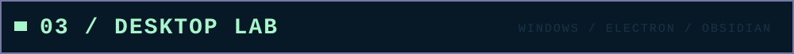
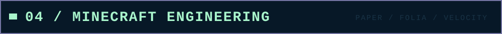
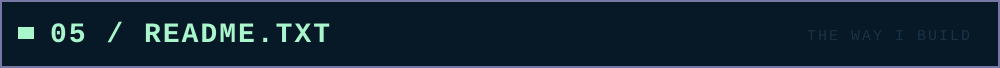

  

<samp>WELCOME TO MY LITTLE CORNER OF THE WEB</samp>

  I'm Artem. I build browser products, Windows utilities and Minecraft infrastructure. 
  Small surfaces, useful depth — from client-side tools to server systems.

  <a href="https://github.com/NetGraniz?tab=repositories"><samp>[ 31 PUBLIC PROJECTS ]</samp></a>
  &nbsp;&nbsp;·&nbsp;&nbsp;
  <a href="https://t.me/NetGraniz"><samp>[ TELEGRAM ]</samp></a>

  <samp>TYPESCRIPT · JAVASCRIPT · JAVA · C# · C++ · PYTHON · AUTOHOTKEY · CLOUDFLARE · ELECTRON · PAPER · FOLIA · VELOCITY</samp>

  

<h2></h2>

<table>
<tr>
<td width="50%" valign="top">
  <h3><samp>01</samp> &nbsp; Gridhaven</h3>
  
A city builder with economy, utilities, zoning and simulation systems.

  
<samp>PHASER / TYPESCRIPT / SIMULATION</samp>

  
<a href="https://city.nord-fjell.com"><samp>[ PLAY → ]</samp></a>

</td>
<td width="50%" valign="top">
  <h3><samp>02</samp> &nbsp; Quiet Mile</h3>
  
An endless procedural drive through a generated 3D landscape.

  
<samp>THREE.JS / PROCEDURAL GENERATION</samp>

  
<a href="https://roads.nord-fjell.com"><samp>[ DRIVE → ]</samp></a>

</td>
</tr>
<tr>
<td width="50%" valign="top">
  <h3><samp>03</samp> &nbsp; Barricade</h3>
  
A 9×9 strategy board game with local play and several AI levels.

  
<samp>STRATEGY / BOARD GAME / AI</samp>

  
<a href="https://barricade.nord-fjell.com"><samp>[ PLAY → ]</samp></a>

</td>
<td width="50%" valign="top">
  <h3><samp>04</samp> &nbsp; Battleship</h3>
  
Classic sea battle against an adaptive computer opponent.

  
<samp>CLASSIC / OFFLINE / AI</samp>

  
<a href="https://battleship.nord-fjell.com"><samp>[ PLAY → ]</samp></a>

</td>
</tr>
<tr>
<td width="50%" valign="top">
  <h3><samp>05</samp> &nbsp; Repo Monster Calculator</h3>
  
A compact team-power calculator for selecting available monsters.

  
<samp>GAME UTILITY / CALCULATOR</samp>

  
<a href="https://repo.nord-fjell.com"><samp>[ OPEN → ]</samp></a>

</td>
<td width="50%" valign="top">
  <h3><samp>06</samp> &nbsp; Nord-Fjell</h3>
  
The home of a Java Minecraft server and its community.

  
<samp>MINECRAFT / COMMUNITY / ELEVENTY</samp>

  
<a href="https://nord-fjell.com"><samp>[ VISIT → ]</samp></a>

</td>
</tr>
</table>

<h2></h2>

<table>
<tr>
<td width="50%" valign="top">
  <h3><samp>01</samp> &nbsp; P2P Call</h3>
  
Private one-to-one browser video calls with TURN fallback.

  
<samp>WEBRTC / DURABLE OBJECTS</samp>

  
<a href="https://p2p.nord-fjell.com"><samp>[ CALL → ]</samp></a>

</td>
<td width="50%" valign="top">
  <h3><samp>02</samp> &nbsp; Password Security Lab</h3>
  
Password analysis, breach checks and secure credential generation.

  
<samp>SECURITY / CLIENT-SIDE</samp>

  
<a href="https://password.nord-fjell.com"><samp>[ CHECK → ]</samp></a>

</td>
</tr>
<tr>
<td width="50%" valign="top">
  <h3><samp>03</samp> &nbsp; Translit</h3>
  
Russian transliteration for passports, licences, GOST and URL slugs.

  
<samp>TEXT / TRANSLITERATION</samp>

  
<a href="https://translit.nord-fjell.com"><samp>[ CONVERT → ]</samp></a>

</td>
<td width="50%" valign="top">
  <h3><samp>04</samp> &nbsp; Trip Cost</h3>
  
Route, fuel, toll and per-person travel budget planning.

  
<samp>TRAVEL / CALCULATOR</samp>

  
<a href="https://trip.nord-fjell.com"><samp>[ PLAN → ]</samp></a>

</td>
</tr>
<tr>
<td width="50%" valign="top">
  <h3><samp>05</samp> &nbsp; Photo OCR</h3>
  
Extract and clean text from images locally in the browser.

  
<samp>OCR / LOCAL PROCESSING</samp>

  
<a href="https://ocr.nord-fjell.com"><samp>[ RECOGNISE → ]</samp></a>

</td>
<td width="50%" valign="top">
  <h3><samp>06</samp> &nbsp; Convert Lab</h3>
  
A lightweight collection of client-side file and image converters.

  
<samp>FILES / CLIENT-SIDE</samp>

  
<a href="https://converters.nord-fjell.com"><samp>[ CONVERT → ]</samp></a>

</td>
</tr>
<tr>
<td colspan="2" valign="top">
  <h3><samp>07</samp> &nbsp; QR Code Studio</h3>
  
Custom QR codes, barcodes, scanning and batch export — fully in the browser.

  
<samp>QR / BARCODE / GENERATOR</samp>

  
<a href="https://qr.nord-fjell.com"><samp>[ CREATE → ]</samp></a>

</td>
</tr>
</table>

<h2></h2>

<table>
<tr>
<td width="50%" valign="top">
  <h3><samp>01</samp> &nbsp; <a href="https://github.com/NetGraniz/NordWall">NordWall</a></h3>
  
A lightweight animated wallpaper engine built specifically for Windows 11.

  
<samp>C# / WINFORMS / WEBVIEW2</samp>

</td>
<td width="50%" valign="top">
  <h3><samp>02</samp> &nbsp; <a href="https://github.com/NetGraniz/NordDisk">NordDisk</a></h3>
  
A native disk temperature and activity monitor with SMART data.

  
<samp>C++ / WIN32 / HARDWARE MONITORING</samp>

</td>
</tr>
<tr>
<td width="50%" valign="top">
  <h3><samp>03</samp> &nbsp; <a href="https://github.com/NetGraniz/local-site-session-tester">Local Site Visitor</a></h3>
  
Controlled testing through parallel, isolated Playwright browser sessions.

  
<samp>ELECTRON / PLAYWRIGHT / WINDOWS</samp>

</td>
<td width="50%" valign="top">
  <h3><samp>04</samp> &nbsp; <a href="https://github.com/NetGraniz/ad_user_tool">AD User Tool</a></h3>
  
Active Directory account creation and onboarding document automation.

  
<samp>PYTHON / ACTIVE DIRECTORY / DOCX</samp>

</td>
</tr>
<tr>
<td width="50%" valign="top">
  <h3><samp>05</samp> &nbsp; Obsidian utilities</h3>
  
<a href="https://github.com/NetGraniz/SyncedVault">SyncedVault</a> adds preview-first Dropbox sync; <a href="https://github.com/NetGraniz/SyncedTrash">SyncedTrash</a> provides a shared recoverable trash.

  
<samp>OBSIDIAN / DROPBOX / PLUGINS</samp>

</td>
<td width="50%" valign="top">
  <h3><samp>06</samp> &nbsp; Small Windows tools</h3>
  
<a href="https://github.com/NetGraniz/NordCursor">NordCursor</a>, <a href="https://github.com/NetGraniz/NordEye">NordEye</a> and <a href="https://github.com/NetGraniz/TerminalTyper">TerminalTyper</a> solve focused desktop tasks with minimal overhead.

  
<samp>AUTOHOTKEY / PRODUCTIVITY</samp>

</td>
</tr>
</table>

<h2></h2>

  The Nord-Fjell stack is a set of focused server components for Paper, Folia and Velocity.
  They cover access, moderation, communication, gameplay and operations without turning into one monolithic plugin.

<table>
<tr>
<td width="50%" valign="top">
  <h3>Network &amp; access</h3>
  
<a href="https://github.com/NetGraniz/NordQueue">NordQueue</a> · <a href="https://github.com/NetGraniz/NordAuth">NordAuth</a> · <a href="https://github.com/NetGraniz/NordPerms">NordPerms</a> · <a href="https://github.com/NetGraniz/NordBans">NordBans</a>

  
<samp>QUEUE / AUTH / PERMISSIONS / BANS</samp>

</td>
<td width="50%" valign="top">
  <h3>Moderation &amp; communication</h3>
  
<a href="https://github.com/NetGraniz/NordFilter">NordFilter</a> · <a href="https://github.com/NetGraniz/NordChat">NordChat</a> · <a href="https://github.com/NetGraniz/NordCommandsPaper">NordCommandsPaper</a> · <a href="https://github.com/NetGraniz/NordCommandsVelocity">NordCommandsVelocity</a> · <a href="https://github.com/NetGraniz/NordDeaths">NordDeaths</a>

  
<samp>CHAT / FILTERING / COMMAND POLICY</samp>

</td>
</tr>
<tr>
<td width="50%" valign="top">
  <h3>Players &amp; world</h3>
  
<a href="https://github.com/NetGraniz/NordHomes">NordHomes</a> · <a href="https://github.com/NetGraniz/NordPets">NordPets</a> · <a href="https://github.com/NetGraniz/NordPhantoms">NordPhantoms</a> · <a href="https://github.com/NetGraniz/NordFireworks">NordFireworks</a> · <a href="https://github.com/NetGraniz/NordRegen">NordRegen</a>

  
<samp>TELEPORTATION / PROTECTION / WORLD TOOLS</samp>

</td>
<td width="50%" valign="top">
  <h3>Operations &amp; visibility</h3>
  
<a href="https://github.com/NetGraniz/NordControl">NordControl</a> · <a href="https://github.com/NetGraniz/NordGuard">NordGuard</a> · <a href="https://github.com/NetGraniz/NordStatus">NordStatus</a> · <a href="https://github.com/NetGraniz/NordTab">NordTab</a> · <a href="https://github.com/NetGraniz/NordPing">NordPing</a> · <a href="https://github.com/NetGraniz/NordQueueTab">NordQueueTab</a> · <a href="https://github.com/NetGraniz/NordQueueNotice">NordQueueNotice</a>

  
<samp>CONTROL / MONITORING / SERVER UX</samp>

</td>
</tr>
</table>

  <strong>Testing the whole path:</strong>
  <a href="https://github.com/NetGraniz/NordLoadTest">NordLoadTest</a> drives Mineflayer clients through queue, authentication and in-world behaviour.

<h2></h2>

<blockquote>
  
<strong>Small surface. Useful depth.</strong>

  
Focused interfaces, local processing where it makes sense, and only as much infrastructure as the product actually needs.

</blockquote>

<samp>LESS FRICTION &nbsp; / &nbsp; FEWER DEPENDENCIES &nbsp; / &nbsp; MORE MAKING</samp>

  Most projects include an English README, a clear licence, reproducible build instructions and downloadable releases when a binary is involved.

  <a href="https://github.com/NetGraniz?tab=repositories"><samp>[ EXPLORE ALL REPOSITORIES → ]</samp></a>

<samp>THANKS FOR STOPPING BY. YOU CAN CLOSE THIS TAB — OR START SOMETHING.</samp> © 2026 NetGraniz · Made for the web, with a soft spot for the old web.

