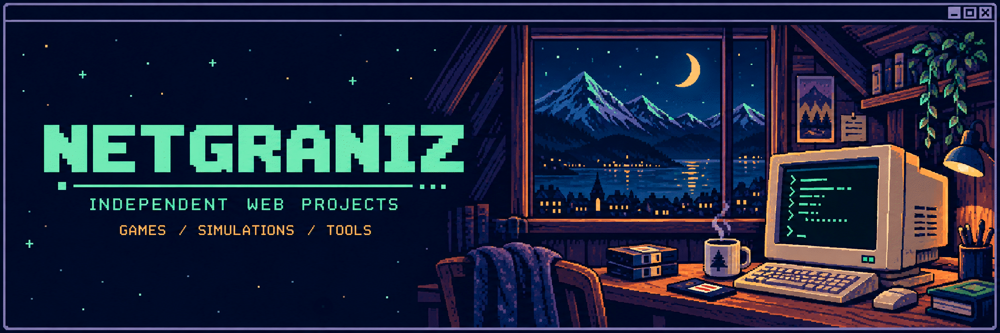
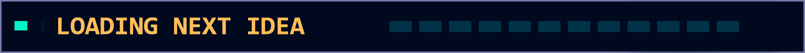
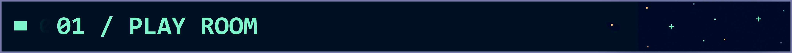
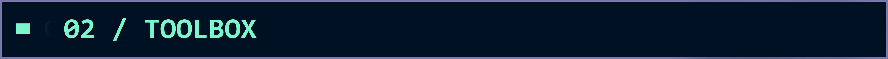
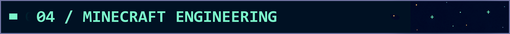
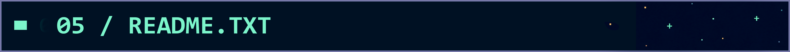

  

<samp>WELCOME TO MY LITTLE CORNER OF THE WEB</samp>

  I'm Artem. I build browser products, Windows utilities and Minecraft infrastructure. 
  Small surfaces, useful depth — from client-side tools to server systems.

  <samp>TYPESCRIPT · JAVASCRIPT · JAVA · C# · C++ · PYTHON · AUTOHOTKEY · CLOUDFLARE · ELECTRON · PAPER · FOLIA · VELOCITY</samp>

  

<h2></h2>

<table>
  <tr>
    <td width="1000" valign="top">
      <h3><samp>01</samp> &nbsp; Quiet Mile</h3>
      
An endless procedural drive through a generated 3D landscape.

      
<samp>THREE.JS / PROCEDURAL GENERATION</samp>

      
<a href="https://roads.nord-fjell.com"><samp>[ DRIVE → ]</samp></a>

    </td>
  </tr>
  <tr>
    <td width="1000" valign="top">
      <h3><samp>02</samp> &nbsp; Nord-Fjell</h3>
      
The home of a Java Minecraft server and its community.

      
<samp>MINECRAFT / COMMUNITY / ELEVENTY</samp>

      
<a href="https://nord-fjell.com"><samp>[ VISIT → ]</samp></a>

    </td>
  </tr>
</table>

<h2></h2>

<table>
<tr>
<td colspan="2" valign="top">
  <h3><samp>01</samp> &nbsp; P2P Call</h3>
  
Private one-to-one browser video calls with TURN fallback.

  
<samp>WEBRTC / DURABLE OBJECTS</samp>

  
<a href="https://p2p.nord-fjell.com"><samp>[ CALL → ]</samp></a>

</td>
</tr>
<tr>
<td width="50%" valign="top">
  <h3><samp>02</samp> &nbsp; Trip Cost</h3>
  
Route, fuel, toll and per-person travel budget planning.

  
<samp>TRAVEL / CALCULATOR</samp>

  
<a href="https://trip.nord-fjell.com"><samp>[ PLAN → ]</samp></a>

</td>
<td width="50%" valign="top">
  <h3><samp>03</samp> &nbsp; Photo OCR</h3>
  
Extract and clean text from images locally in the browser.

  
<samp>OCR / LOCAL PROCESSING</samp>

  
<a href="https://ocr.nord-fjell.com"><samp>[ RECOGNISE → ]</samp></a>

</td>
</tr>
<tr>
<td colspan="2" valign="top">
  <h3><samp>04</samp> &nbsp; Kin Ledger</h3>
  
A private-by-default expense and salary tracker where each account can create a family workspace, plan recurring costs and keep personal income records.

  
<samp>REACT / TYPESCRIPT / CLOUDFLARE WORKERS / D1</samp>

  
<a href="https://expenses.nord-fjell.com"><samp>[ OPEN LEDGER → ]</samp></a>

</td>
</tr>
</table>

<h2></h2>

<table>
<tr>
<td width="50%" valign="top">
  <h3><samp>01</samp> &nbsp; <a href="https://github.com/NetGraniz/NordWall">NordWall</a></h3>
  
A lightweight animated wallpaper engine built specifically for Windows 11.

  
<samp>C# / WINFORMS / WEBVIEW2</samp>

</td>
<td width="50%" valign="top">
  <h3><samp>02</samp> &nbsp; <a href="https://github.com/NetGraniz/NordDisk">NordDisk</a></h3>
  
A native disk temperature and activity monitor with SMART data.

  
<samp>C++ / WIN32 / HARDWARE MONITORING</samp>

</td>
</tr>
<tr>
<td width="50%" valign="top">
  <h3><samp>03</samp> &nbsp; Obsidian utilities</h3>
  
<a href="https://github.com/NetGraniz/SyncedVault">SyncedVault</a> adds preview-first Dropbox sync; <a href="https://github.com/NetGraniz/SyncedTrash">SyncedTrash</a> provides a shared recoverable trash.

  
<samp>OBSIDIAN / DROPBOX / PLUGINS</samp>

</td>
<td width="50%" valign="top">
  <h3><samp>04</samp> &nbsp; Small Windows tools</h3>
  
<a href="https://github.com/NetGraniz/NordCursor">NordCursor</a>, <a href="https://github.com/NetGraniz/NordEye">NordEye</a>, <a href="https://github.com/NetGraniz/TerminalTyper">TerminalTyper</a> and <a href="https://github.com/NetGraniz/asus-keyboard-backlight">ASUS Keyboard Backlight</a> solve focused desktop tasks with minimal overhead.

  
<samp>C# / AUTOHOTKEY / HARDWARE CONTROL / PRODUCTIVITY</samp>

</td>
</tr>
</table>

<h2></h2>

<table width="100%">
<tr>
<td width="500" valign="top">
  <h3><samp>01</samp> &nbsp; Network &amp; access</h3>
  
<a href="https://github.com/NetGraniz/NordQueue">NordQueue</a> · <a href="https://github.com/NetGraniz/NordAuth">NordAuth</a> · <a href="https://github.com/NetGraniz/NordBans">NordBans</a>

  
<samp>QUEUE / AUTH / PERMISSIONS / BANS</samp>

</td>
<td width="500" valign="top">
  <h3><samp>02</samp> &nbsp; Moderation &amp; communication</h3>
  
<a href="https://github.com/NetGraniz/NordChat">NordChat</a> · <a href="https://github.com/NetGraniz/NordCommands">NordCommands</a>

  
<samp>CHAT / FILTERING / COMMAND POLICY</samp>

</td>
</tr>
<tr>
<td width="500" valign="top">
  <h3><samp>03</samp> &nbsp; Players &amp; world</h3>
  
<a href="https://github.com/NetGraniz/NordHomes">NordHomes</a> · <a href="https://github.com/NetGraniz/NordPhantoms">NordPhantoms</a> · <a href="https://github.com/NetGraniz/NordFireworks">NordFireworks</a> · <a href="https://github.com/NetGraniz/NordRegen">NordRegen</a>

  
<samp>TELEPORTATION / PROTECTION / WORLD TOOLS</samp>

</td>
<td width="500" valign="top">
  <h3><samp>04</samp> &nbsp; Operations &amp; visibility</h3>
  
<a href="https://github.com/NetGraniz/NordControl">NordControl</a> · <a href="https://github.com/NetGraniz/NordStatus">NordStatus</a>

  
<samp>CONTROL / MONITORING / SERVER UX</samp>

</td>
</tr>
</table>

<h2></h2>

<table>
  <tr>
    <td width="1000" valign="top">
      <h3><samp>01</samp> &nbsp; About</h3>
      
Most projects include an English README, a clear licence, reproducible build instructions and downloadable releases when a binary is involved.

        
<samp>LESS FRICTION / FEWER DEPENDENCIES</samp>

    </td>
  </tr>
</table>

  <a href="https://github.com/NetGraniz?tab=repositories"><samp>[ EXPLORE ALL REPOSITORIES → ]</samp></a>

<samp>THANKS FOR STOPPING BY. YOU CAN CLOSE THIS TAB — OR START SOMETHING.</samp> © 2026 NetGraniz · Made for the web, with a soft spot for the old web.

